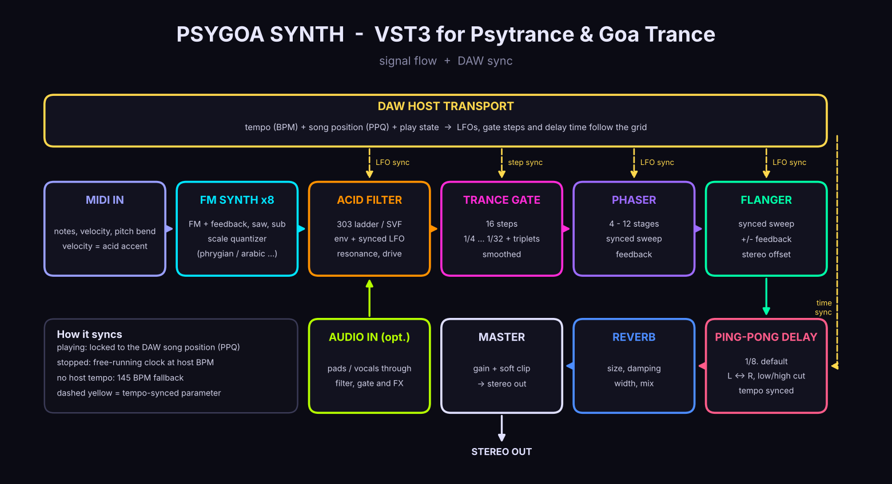

# PsyGoa Synth (VST3)

Ein VST3-Instrument für **Psytrance & Goa Trance** (JUCE / C++17): FM-Lead-Synth, 303-Acid-Filter, Trance-Gate,
Phaser, Flanger, Ping-Pong-Delay und Reverb – alles **tempo-synchron zur DAW**. Mit **100 Factory-Presets**.



## Features

| Baustein | Umsetzung |
|---|---|
| **FM-Synthese-Leads** | 8 Stimmen, Modulator → Carrier (Ratio, Index, Index-Decay, Feedback), optionaler Saw-Layer (2× detuned, PolyBLEP) und Sub. Mono-Modus mit Glide (303-Style). |
| **Orientalische Skalen** | Scale-Quantizer: Phrygian, Phrygian Dominant, Double Harmonic (Arabisch), Persian, Harmonic Minor, Natural Minor, Minor Pentatonic + Grundton. Jede Taste rastet auf die Skala ein. |
| **Resonanter Acid-Filter** | 4-Pol-Ladder (TB-303-Charakter, übersteuert über tanh) sowie SVF LP12 / BP / HP. Hüllkurve (Velocity = Accent), Drive, LFO (Sine/Tri/Saw/Square) frei oder **tempo-synchron**. |
| **Trance-Gate** | 16-Step-Pattern (klickbarer Step-Editor), Raster 1/4 … 1/32 inkl. Triolen, Depth, Smooth. Läuft auf der Song-Position der DAW. |
| **Phaser / Flanger** | 4–12 Stufen bzw. modulierte Delayline, Feedback ±, Stereo-Versatz, Rate frei oder **synchron** (4/1 … 1/32). |
| **Ping-Pong-Delay** | Tempo-synchron (Standard 1/8.), L↔R-Anteil regelbar, Low-/High-Cut im Feedback. |
| **Reverb** | Size, Damping, Width, Mix. |
| **DAW-Sync** | Tempo + PPQ-Position vom Host. Bei Stop läuft eine freie Uhr mit dem Host-BPM weiter, ohne Host-Tempo 145 BPM. |
| **FX-Eingang (optional)** | Aktivierst du den Audio-Eingang des Plugins, laufen Pads/Vocals durch Filter → Gate → FX. |
| **100 Presets** | Auch als Host-Programme sichtbar (Preset-Browser der DAW). Liste: [`Presets/PRESET_LIST.md`](Presets/PRESET_LIST.md) |

Signalweg: `Synth (+ Audio-In) → Acid-Filter → Trance-Gate → Phaser → Flanger → Ping-Pong-Delay → Reverb → Master (Soft-Clip)`

## Presets (10 Kategorien × 10)

Acid Lead · Psy Bass · FM Oriental · Gate Pad · Acid Bass · Phase Flange · PingPong Lead · Hypno Pluck · Dark Forest · Atmosphere

Die Presets entstehen reproduzierbar aus `tools/generate.py` (Kategorie-Vorlagen + deterministische Variationen).
Das Skript ist die einzige Quelle für alle Parameter und Presets: ändern, `python3 tools/generate.py` ausführen, fertig.

## Bauen

### Über GitHub Actions (empfohlen)
1. Repository auf GitHub pushen.
2. Tab **Actions → Build VST3** läuft automatisch (Windows, macOS universal, Linux).
3. Fertige `.vst3` unter *Artifacts*. Mit einem Tag `v1.0.0` wird zusätzlich ein **Release** mit ZIPs erstellt.

### Lokal
```bash
cmake -B build -DCMAKE_BUILD_TYPE=Release
cmake --build build --config Release --target PsyGoaSynth_VST3
# Ergebnis: build/PsyGoaSynth_artefacts/Release/VST3/PsyGoa Synth.vst3
```
JUCE 8.0.6 wird beim ersten Configure automatisch geladen (Internet nötig).
Linux-Abhängigkeiten: siehe `.github/workflows/build.yml`.

### DSP-Test (ohne JUCE)
```bash
g++ -std=c++17 -O2 -fsanitize=address,undefined tests/dsp_test.cpp -o dsp_test && ./dsp_test
```

## Installation
| OS | Ordner |
|---|---|
| Windows | `C:\Program Files\Common Files\VST3\` |
| macOS | `~/Library/Audio/Plug-Ins/VST3/` |
| Linux | `~/.vst3/` |

Als **Instrument-Spur** laden, MIDI-Noten spielen. Für Pads/Vocals den Plugin-Audioeingang (Sidechain/FX-Input) der DAW aktivieren.

## Projektstruktur
```
Source/dsp/        FMSynth, AcidFilter, TranceGate, ModFx (Phaser/Flanger), PingPongDelay  (reines C++, getestet)
Source/            PluginProcessor, PluginEditor (GUI), Params, Presets
Source/generated/  automatisch erzeugt (Parameter + Preset-Daten)
tools/             generate.py (Parameter/Presets), make_workflow_image.py (Workflow-Bild)
tests/             dsp_test.cpp
.github/workflows/ build.yml (CI, Release)
```

## Hinweise
* Die DSP-Module sind mit Sanitizern getestet (stabil, endliche Werte, auch bei Extremwerten). Das JUCE-Plugin selbst
  (Processor/GUI) wird erst in der CI kompiliert – falls dort ein Fehler auftritt, bitte das Actions-Log als Issue posten.
* Erstes Plugin-Laden: Pluginscan der DAW neu starten.

## Lizenz
JUCE steht unter **AGPLv3** (oder kommerzieller Lizenz). Dieses Projekt ist daher als **AGPL-3.0** veröffentlicht, siehe `LICENSE`.
